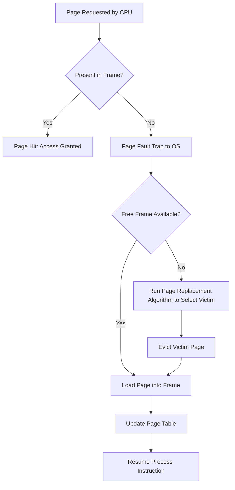

# Experiment 5: Page Replacement Algorithms (FIFO, Optimal, LRU)

> **Author:** Yug Shah (TYCSE)  
> **Repository:** Os from scratch  
> **Course:** Operating Systems Lab  

## 1. Aim
To implement and analyze different page replacement algorithms such as FIFO, Optimal, and LRU using C programming.

## 2. Course Outcome & Learning Objectives
- **Course Outcome (CO):** Evaluate memory management schemes, including paging, segmentation, and virtual memory, using various page replacement algorithms.
- **Learning Objectives:**
  - Understand virtual memory concepts, demand paging, page hits, and page faults.
  - Implement First-In-First-Out (FIFO), Optimal (OPT), and Least Recently Used (LRU) algorithms.
  - Calculate total page faults and page hit ratios for a given page reference string.
  - Understand Belady's Anomaly in FIFO.
  - Compare practical feasibility vs theoretical optimality.

---

## 3. Related Theory

### 3.1 Virtual Memory & Demand Paging
Virtual memory allows the execution of processes that may not be completely mapped in physical RAM. When a process attempts to access a virtual memory page that is not currently mapped into physical memory, the Memory Management Unit (MMU) generates a hardware trap called a **Page Fault**.

When a page fault occurs:
1. The OS pauses the process.
2. If free physical frames exist, the requested page is brought in from secondary storage (disk swap).
3. If all physical frames are occupied, a **page replacement algorithm** selects a "victim frame" to be evicted to make room.
4. The page table is updated, and the process resumes execution.



---

### 3.2 Page Replacement Strategies

#### 1. FIFO (First In First Out)
- **Principle:** Replaces the page that has been in physical memory the longest.
- **Data Structure:** Circular queue or modulo index counter (`(index + 1) % frames`).
- **Advantage:** Low overhead, very simple to implement.
- **Disadvantage:** May evict frequently used initialization variables. Suffer from **Belady's Anomaly** (increasing the number of allocated frames can paradoxically increase the number of page faults).

#### 2. Optimal Algorithm (OPT / MIN / Clairvoyant)
- **Principle:** Replaces the page that will **not be used for the longest period of time in the future**.
- **Advantage:** Lowest possible page fault rate for any fixed number of frames. Never suffers from Belady's Anomaly.
- **Disadvantage:** Cannot be implemented in a general-purpose operating system because it requires future knowledge of memory references. It serves as an upper benchmark for evaluating practical algorithms.

#### 3. LRU (Least Recently Used)
- **Principle:** Replaces the page that has not been referenced for the longest period in the past (backward-looking approximation of Optimal).
- **Implementation:** Counter-based timestamp or doubly-linked list stack.
- **Advantage:** High hit ratio; closely approximates the optimal algorithm without needing future lookahead. Does not suffer from Belady's Anomaly (stack algorithm).
- **Disadvantage:** Substantial hardware support or software bookkeeping overhead to update timestamps on every memory reference.

---

## 4. Program Descriptions

| Source File | Algorithm | Description |
| :--- | :--- | :--- |
| `fifo.c` | FIFO | Implements circular queue pointer to replace the oldest frame. |
| `optimal.c` | Optimal | Scans forward into future reference stream to locate the farthest referenced page. |
| `lru.c` | LRU | Tracks an incremental timestamp counter on each access to evict the least recently used page. |

---

## 5. Compilation and Execution

### Compiling
```bash
gcc -Wall -o fifo fifo.c
gcc -Wall -o optimal optimal.c
gcc -Wall -o lru lru.c
```

### Running
```bash
./fifo
./optimal
./lru
```

---

## 6. Sample Input & Output (from Lab Manual)

### Input Data
- Number of frames: `3`
- Number of pages: `9`
- Reference string: `8 5 2 3 5 8 3 8 2`

### 6.1 FIFO Output
```text
Enter number of frames: 3
Enter number of pages: 9
Enter reference string:
8 5 2 3 5 8 3 8 2

--- Simulation Step-by-Step ---
Page  8 -> [FAULT] Frames: 8 - - 
Page  5 -> [FAULT] Frames: 8 5 - 
Page  2 -> [FAULT] Frames: 8 5 2 
Page  3 -> [FAULT] Frames: 3 5 2 
Page  5 -> [ HIT ] Frames: 3 5 2 
Page  8 -> [FAULT] Frames: 3 8 2 
Page  3 -> [ HIT ] Frames: 3 8 2 
Page  8 -> [ HIT ] Frames: 3 8 2 
Page  2 -> [ HIT ] Frames: 3 8 2 

Total Page Faults (FIFO) = 5
Total Page Hits   (FIFO) = 4
```

### 6.2 Optimal Output
```text
Enter number of frames: 3
Enter number of pages: 9
Enter reference string:
8 5 2 3 5 8 3 8 2

--- Simulation Step-by-Step ---
Page  8 -> [FAULT] Frames: 8 - - 
Page  5 -> [FAULT] Frames: 8 5 - 
Page  2 -> [FAULT] Frames: 8 5 2 
Page  3 -> [FAULT] Frames: 8 5 3 
Page  5 -> [ HIT ] Frames: 8 5 3 
Page  8 -> [ HIT ] Frames: 8 5 3 
Page  3 -> [ HIT ] Frames: 8 5 3 
Page  8 -> [ HIT ] Frames: 8 5 3 
Page  2 -> [FAULT] Frames: 2 5 3 

Total Page Faults (Optimal) = 5
Total Page Hits   (Optimal) = 4
```

### 6.3 LRU Output
```text
Enter number of frames: 3
Enter number of pages: 9
Enter reference string:
8 5 2 3 5 8 3 8 2

--- Simulation Step-by-Step ---
Page  8 -> [FAULT] Frames: 8 - - 
Page  5 -> [FAULT] Frames: 8 5 - 
Page  2 -> [FAULT] Frames: 8 5 2 
Page  3 -> [FAULT] Frames: 3 5 2 
Page  5 -> [ HIT ] Frames: 3 5 2 
Page  8 -> [FAULT] Frames: 3 5 8 
Page  3 -> [ HIT ] Frames: 3 5 8 
Page  8 -> [ HIT ] Frames: 3 5 8 
Page  2 -> [FAULT] Frames: 2 5 8 

Total Page Faults (LRU) = 6
Total Page Hits   (LRU) = 3
```

---

## 7. Viva Voce & Interview Questions with Answers

### Q1: What is a Page Fault?
**Answer:**
A page fault is an interrupt (trap) raised by the hardware Memory Management Unit (MMU) when a program accesses a page in virtual address space that is mapped as "not present" in physical memory (RAM).

### Q2: What is Belady's Anomaly? Which algorithm suffers from it?
**Answer:**
Belady's Anomaly is the phenomenon in which increasing the number of physical page frames allocated to a process results in an **increase** (rather than a decrease) in the number of page faults for certain reference strings.
- **FIFO** suffers from Belady's Anomaly.
- Stack algorithms like **LRU** and **Optimal** are mathematically proven to never suffer from Belady's Anomaly.

### Q3: Why is the Optimal page replacement algorithm not practically implementable in real-world operating systems?
**Answer:**
The Optimal algorithm requires exact future knowledge of which pages will be referenced and when. Because an OS cannot foresee the nondeterministic execution path of user programs (such as user input branches, loops, and network packets), it cannot predict future references in advance. It is used as a theoretical benchmark.

### Q4: What is Thrashing in virtual memory?
**Answer:**
Thrashing occurs when a computer's virtual memory subsystem is in a constant state of paging—rapidly moving pages in and out between physical memory and swap disk—spending vastly more CPU time swapping pages than actually executing user instructions. System throughput plunges toward zero.

### Q5: How does LRU determine which page to evict?
**Answer:**
LRU operates on the heuristic of locality of reference: pages that were used recently are likely to be used again soon. It inspects the historical reference timestamp of all frames and replaces the frame whose last reference was furthest in the past.

---

## 8. Conclusion
The experiment demonstrated the working and trade-offs of FIFO, Optimal, and LRU page replacement policies. The Optimal algorithm achieves minimum page faults, while LRU offers an effective, practical approximation for modern operating system virtual memory managers.

