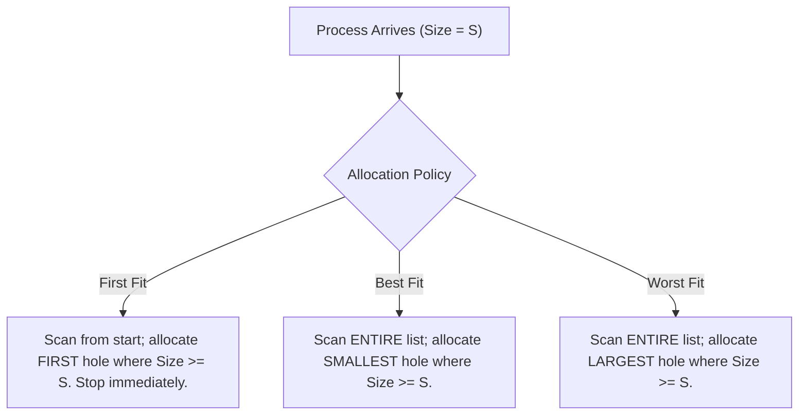

# Experiment 9: Memory Allocation Strategies (First Fit, Best Fit, Worst Fit)

> **Author:** Yug Shah (TYCSE)  
> **Repository:** Os from scratch  
> **Course:** Operating Systems Lab  

## 1. Aim
To implement and compare different dynamic memory allocation algorithms: First Fit, Best Fit, and Worst Fit using C programming.

## 2. Course Outcome & Learning Objectives
- **Course Outcome (CO):** Evaluate memory management schemes, including allocation techniques for efficient utilization of memory.
- **Learning Objectives:**
  - Understand contiguous memory management and dynamic partitioning in operating systems.
  - Analyze and contrast Internal Fragmentation vs External Fragmentation.
  - Implement First Fit, Best Fit, and Worst Fit algorithms in C.
  - Evaluate search overhead, remaining hole fragmentation, and allocation success rates.

---

## 3. Related Theory

### 3.1 Partitioning and Fragmentation
- **Fixed Partitioning:** Physical memory is divided into fixed, static boundaries. A process placed into a partition larger than itself causes **Internal Fragmentation** (unused memory within the allocated block).
- **Dynamic Partitioning:** Partitions are created dynamically to match the exact size requested by a process. As processes terminate, memory becomes broken up into disconnected free segments called "holes". Over time, this leads to **External Fragmentation** (total free memory is sufficient to satisfy a request, but the memory is non-contiguous).
- **Compaction:** An OS memory management technique that shifts all running processes to one end of physical memory to combine all scattered holes into one large contiguous block (requires dynamic relocation hardware).

---

### 3.2 Allocation Strategies



| Algorithm | Search Mechanism | Pros | Cons |
| :--- | :--- | :--- | :--- |
| **First Fit** | Allocates the first hole large enough starting from the beginning. | **Fastest execution**: stops searching as soon as a suitable block is found. | Leaves small unusable fragments near the beginning of memory; requires periodic compaction. |
| **Best Fit** | Searches all holes to find the smallest hole that is at least as large as the process. | Minimizes unused space in the chosen block; preserves larger blocks for large processes. | **Slow**: must traverse all blocks. Leaves behind tiny, unusable residual fragments throughout memory. |
| **Worst Fit** | Searches all holes to find the largest available hole. | Produces the largest residual leftover hole, which is more likely to be useful for subsequent processes. | **Slow**: must search all blocks. Rapidly destroys large contiguous blocks needed by large jobs. |

---

## 4. Source Files

| File | Description |
| :--- | :--- |
| `memory_allocation.c` | Unified program (as per lab manual) running First Fit, Best Fit, and Worst Fit sequentially on the same inputs. |
| `first_fit.c` | Standalone implementation of First Fit. |
| `best_fit.c` | Standalone implementation of Best Fit. |
| `worst_fit.c` | Standalone implementation of Worst Fit. |

---

## 5. How to Compile and Run

### Compiling
```bash
# Compile unified comparison program
gcc -Wall -o memory_allocation memory_allocation.c

# Or compile individual programs
gcc -Wall -o first_fit first_fit.c
gcc -Wall -o best_fit best_fit.c
gcc -Wall -o worst_fit worst_fit.c
```

### Running
```bash
./memory_allocation
```

---

## 6. Sample Input & Output (from Lab Manual)

### Input Data
- Number of memory blocks: `3`
- Number of processes: `3`
- Block sizes: `100 500 200`
- Process sizes: `120 50 180`

### Output
```text
===================================================
    MEMORY ALLOCATION: FIRST FIT, BEST FIT, WORST FIT 
===================================================
Enter number of memory blocks: 3
Enter number of processes: 3
Enter size of blocks:
100 500 200
Enter size of processes:
120 50 180

--- First Fit ---
Process 1 allocated to Block 2
Process 2 allocated to Block 1
Process 3 allocated to Block 2

--- Best Fit ---
Process 1 allocated to Block 3
Process 2 allocated to Block 1
Process 3 allocated to Block 2

--- Worst Fit ---
Process 1 allocated to Block 2
Process 2 allocated to Block 2
Process 3 allocated to Block 2
```

---

## 7. Viva Voce & Interview Questions with Answers

### Q1: What is the difference between Internal and External Fragmentation?
**Answer:**
- **Internal Fragmentation:** Occurs when fixed-size memory partitions are allocated to processes smaller than the partition. The unallocated space inside the partition is wasted and cannot be used by any other process.
- **External Fragmentation:** Occurs in dynamic partitioning when memory is repeatedly allocated and deallocated. The total free memory is large enough to satisfy a request, but because it is broken into multiple non-contiguous fragments, the request cannot be satisfied.

### Q2: Why is First Fit generally faster than Best Fit and Worst Fit?
**Answer:**
First Fit terminates its search immediately upon encountering the first free block that satisfies the size criteria ($O(1)$ in the best case, $O(n)$ in the worst case). Best Fit and Worst Fit must unconditionally traverse the entire list of free partitions ($O(n)$ always) to determine the absolute minimum or maximum sized hole.

### Q3: What is Next Fit?
**Answer:**
Next Fit is a variant of First Fit that resumes searching from the location of the last allocation rather than starting from the beginning of the free memory list every time. This distributes allocations across memory and prevents tiny fragments from clustering at the start.

### Q4: Which algorithm generally produces the smallest leftover fragments?
**Answer:**
**Best Fit** produces the smallest leftover fragments because it chooses the hole whose size is closest to the requested size. Consequently, the remainder hole is often too small to be useful for any future process.

---

## 8. Conclusion
The experiment demonstrated the mechanics of contiguous dynamic memory allocation. While Best Fit minimizes per-allocation waste and First Fit maximizes speed, each approach presents distinct fragmentation profiles that must be weighed when designing memory managers.

