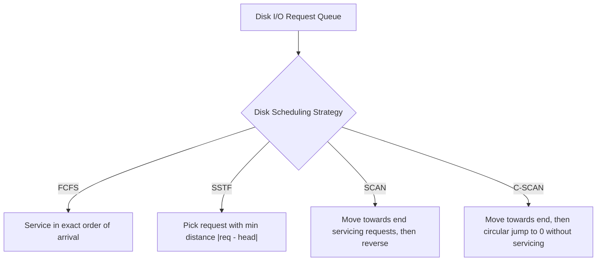

# Experiment 10: Disk Scheduling Algorithms (FCFS, SSTF, SCAN, C-SCAN)

> **Author:** Yug Shah (TYCSE)  
> **Repository:** Os from scratch  
> **Course:** Operating Systems Lab  

## 1. Aim
To implement and analyze different disk scheduling algorithms: FCFS, SSTF, SCAN, and C-SCAN.

## 2. Course Outcome & Learning Objectives
- **Course Outcome (CO):** Analyze file system organization, storage allocation methods, and disk scheduling techniques for efficiency and performance.
- **Learning Objectives:**
  - Understand physical disk geometry (platters, tracks, cylinders, sectors).
  - Understand the components of disk access latency: seek time, rotational delay, and transfer time.
  - Implement FCFS, SSTF, SCAN (Elevator), and C-SCAN (Circular SCAN) algorithms in C.
  - Calculate and compare total head movements and average seek times.
  - Analyze starvation and request turnaround fairness.

---

## 3. Related Theory

### 3.1 Hard Disk Architecture & Latency Components
A magnetic disk consists of rotating magnetic platters and read/write heads positioned on a moving disk arm.
Total access time is composed of:
1. **Seek Time:** The time required for the disk arm to move the read/write head to the desired cylinder/track. *(This is the primary bottleneck optimized by disk scheduling).*
2. **Rotational Latency:** The time taken for the desired sector to rotate underneath the read/write head.
3. **Transfer Time:** The time required to stream data bytes from the sector into system memory.

---

### 3.2 Disk Scheduling Algorithms



#### 1. FCFS (First Come First Serve)
- **Principle:** Requests are serviced strictly in arrival order.
- **Advantage:** Completely fair; no request starvation.
- **Disadvantage:** Wild oscillations across disk platters; highest seek time and poor I/O throughput.

#### 2. SSTF (Shortest Seek Time First)
- **Principle:** Services the request that requires the least head movement from the current position:
  $$\min |req_j - head|$$
- **Advantage:** Substantially reduces seek time compared to FCFS.
- **Disadvantage:** Prone to **starvation** of distant cylinders if new requests continually arrive close to the current head location.

#### 3. SCAN (Elevator Algorithm)
- **Principle:** The disk arm starts at the current head position and sweeps in one direction (e.g., towards highest cylinder `size - 1`), servicing requests along the way. Upon reaching the end cylinder boundary, it reverses direction and services requests on the way back.
- **Advantage:** High throughput, avoids starvation.
- **Disadvantage:** Requests at the opposite end wait longer; non-uniform waiting distribution.

#### 4. C-SCAN (Circular SCAN)
- **Principle:** Like SCAN, moves in one direction servicing requests until the end cylinder. However, upon reaching the disk boundary, it immediately jumps back to cylinder 0 **without servicing any requests on the return journey**, and begins sweeping forward again.
- **Advantage:** Provides a much more **uniform waiting time** across all cylinders.

---

## 4. Source Files

| File | Algorithm | Characteristics |
| :--- | :--- | :--- |
| `fcfs_disk.c` | FCFS | Direct sequential loop summing $|req_i - head|$. |
| `sstf_disk.c` | SSTF | Greedy search over unvisited requests for minimum delta. |
| `scan_disk.c` | SCAN | Ascending sort; sweeps right to cylinder 199, then reverses left. |
| `cscan_disk.c` | C-SCAN | Ascending sort; sweeps right to cylinder 199, jumps to 0, sweeps right. |

---

## 5. How to Compile and Run

### Compiling
```bash
gcc -Wall -o fcfs_disk fcfs_disk.c
gcc -Wall -o sstf_disk sstf_disk.c
gcc -Wall -o scan_disk scan_disk.c
gcc -Wall -o cscan_disk cscan_disk.c
```

### Running
```bash
./fcfs_disk
./sstf_disk
./scan_disk
./cscan_disk
```

---

## 6. Sample Inputs & Outputs (from Lab Manual)

### Common Dataset 1 (FCFS, SSTF, SCAN)
- Request sequence: `82 170 43 140 24 16 190` (7 requests)
- Initial head position: `50`
- Disk boundary: `size = 200` (cylinders 0 to 199)

#### 6.1 FCFS Output
```text
Enter number of requests: 7
Enter request sequence:
82 170 43 140 24 16 190
Enter initial head position: 50

Head Movement Sequence:
50 -> 82 -> 170 -> 43 -> 140 -> 24 -> 16 -> 190

Total Seek Time (FCFS): 642
Average Seek Time: 91.71
```

#### 6.2 SSTF Output
```text
Enter number of requests: 7
Enter request sequence:
82 170 43 140 24 16 190
Enter initial head position: 50

Head Movement Sequence:
50 -> 43 -> 24 -> 16 -> 82 -> 140 -> 170 -> 190

Total Seek Time (SSTF): 208
Average Seek Time: 29.71
```

#### 6.3 SCAN Output
```text
Enter number of requests: 7
Enter request sequence:
82 170 43 140 24 16 190
Enter initial head position: 50

Head Movement Sequence:
50 -> 82 -> 140 -> 170 -> 190 -> 199 [End] -> 43 -> 24 -> 16

Total Seek Time (SCAN): 332
Average Seek Time: 47.43
```

---

### Dataset 2 (C-SCAN)
- Request sequence: `98 183 41 122 14 124 65 67` (8 requests)
- Initial head position: `53`
- Disk boundary: `size = 200` (cylinders 0 to 199)

#### 6.4 C-SCAN Output
```text
Enter number of requests: 8
Enter request sequence:
98 183 41 122 14 124 65 67
Enter initial head position: 53

Head Movement Sequence:
53 -> 65 -> 67 -> 98 -> 122 -> 124 -> 183 -> 199 [End] -> 0 [Jump to Start] -> 14 -> 41

Total Seek Time (C-SCAN): 386
Average Seek Time: 48.25
```

---

## 7. Viva Voce & Interview Questions with Answers

### Q1: What is Seek Time versus Rotational Latency?
**Answer:**
- **Seek Time:** The mechanical delay for the actuator arm to physically move the read/write head assembly radially to align with the target concentric cylinder.
- **Rotational Latency:** The angular delay waiting for the requested sector to rotate beneath the flying head once the cylinder is reached. On average, it equals half the period of one disk rotation.

### Q2: Why is SSTF prone to starvation?
**Answer:**
SSTF continuously favors requests that are nearest to the current head location. If new I/O requests keep arriving close to where the head is currently operating, requests destined for distant cylinders will be repeatedly delayed and may starve indefinitely.

### Q3: Why is SCAN called the "Elevator Algorithm"?
**Answer:**
Because it mimics the behavior of a building elevator: it continues in one direction servicing all floor requests (or track requests) until it reaches the topmost/furthest request or building extremity, and only then does it reverse direction.

### Q4: Why is C-SCAN preferred over SCAN in terms of wait time fairness?
**Answer:**
In SCAN, cylinders near the middle of the disk are traversed twice per round trip (once going forward and once returning), while cylinders at either edge are traversed only once. In C-SCAN, by returning immediately to track 0 without servicing on the return trip, it treats the disk cylinders as a circular list, ensuring all tracks receive an equitable, uniform wait time.

### Q5: How does LOOK and C-LOOK differ from SCAN and C-SCAN?
**Answer:**
SCAN and C-SCAN always travel all the way to the physical boundary cylinders (track 0 or track 199), even if no requests exist beyond the furthest pending request. **LOOK** and **C-LOOK** inspect ("look") ahead and only travel as far as the final request in each direction before reversing or returning, eliminating wasted head movement to the physical edge.

---

## 8. Conclusion
The experiment demonstrated the practical implementation and performance differences among FCFS, SSTF, SCAN, and C-SCAN disk scheduling algorithms. SSTF achieves minimal seek time but suffers from starvation, while SCAN and C-SCAN provide predictable, well-balanced throughput for multi-user operating systems.

